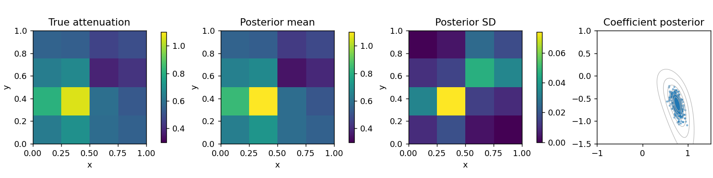

# Langevin Algorithms in PyTorch — LaFA

**The Langevin Algorithms Family (LaFA)** is a PyTorch research library for gradient-based Bayesian sampling and uncertainty quantification. It implements the **unadjusted Langevin algorithm (ULA)** and **Metropolis-adjusted Langevin algorithm (MALA)**, together with kinetic, adaptive and specialized Langevin methods, Stein particle inference and diagnostics.

Langevin algorithms use gradients and random noise to explore a target probability distribution. Start with the [Langevin algorithms guide](langevin-algorithms.md) for the equations, the ULA–MALA distinction and method selection, or open the [six executed tutorials](tutorials.md) to compare actual results.

**Version 0.1.0 · Python 3.11+ · PyTorch 2.6+ · MIT license**

[Source code on GitHub](https://github.com/izzatum/The-Langevin-algorithms-Family) · [API guide](api.md) · [Algorithm register](research/algorithm-register.md) · [Scientific references](references.md)

## Who is LaFA for?

LaFA supports researchers and developers who want to inspect sampling formulas, use PyTorch potentials, compare inference methods and propagate uncertainty through inverse problems. Targets include analytic distributions, full-data neural-network models, straight-ray seismic tomography and nonlinear spatial fields. Its explicit target and state contracts make the sampling objective and implementation choices inspectable.



This output comes from tutorial 6: noisy transmission rays constrain two smooth spatial inclusions. Each posterior draw is transformed through the nonlinear field map before summarizing field uncertainty. The [tutorial guide](tutorials.md) distinguishes this reduced example from the separate full-grid benchmark.

## Install and sample

Install the source checkout with CPU PyTorch:

```bash
git clone https://github.com/izzatum/The-Langevin-algorithms-Family.git
cd The-Langevin-algorithms-Family
python -m venv .venv
source .venv/bin/activate
python -m pip install torch --index-url https://download.pytorch.org/whl/cpu
python -m pip install -e '.[test,notebooks]'
```

The following MALA example advances 32 independent chains for a correlated Gaussian. Its small budget demonstrates the API; it does not establish convergence.

```python
import torch
from lafa.problems import Gaussian
from lafa.samplers import MALA

target = Gaussian([0., 0.], [[1., 0.5], [0.5, 1.]])
chain = MALA(target, torch.zeros(32, 2, dtype=torch.float64),
             step_size=0.1, generator=torch.Generator().manual_seed(7))
chain.advance(200)
result = chain.step(fields=('position', 'accepted'))
print(result['position'].shape)  # torch.Size([32, 2])
```

Supply a scalar negative log density for one state, or one value per batched state. Root classes such as `lafa.MALA` also accept `torch.nn.Parameter` objects and a repeatable closure, similar to a PyTorch optimizer. Use deterministic full-data potentials for corrected sampling. The [API guide](api.md) covers targets, devices, gradients and checkpoints.

## Choose a workflow

| Goal | Start here | What to inspect |
|---|---|---|
| Learn ULA, MALA and adaptive steps | [Tutorial 1: overdamped methods](../notebooks/01_overdamped.ipynb) | Step bias, acceptance, R-hat, ESS and MCSE |
| Compare momentum and higher derivatives | [Tutorial 2: kinetic and higher-order methods](../notebooks/02_inertial.ipynb) | Kinetic Euler, BAOAB and overdamped HOLA; derivative cost |
| Explore temperatures or latent learning | [Tutorial 3: specialized methods](../notebooks/03_specialized.ipynb) | Annealing, replica exchange and proximal shared-parameter learning |
| Approximate a distribution with particles | [Tutorial 4: Stein methods](../notebooks/04_stein_particles.ipynb) | SVGD, projected and Newton variants, function-space maps |
| Examine sample quality with kernels | [Tutorial 5: KSD](../notebooks/05_ksd.ipynb) | IMQ/RBF estimators and a missed-mode counterexample |
| Study ensembles and inverse problems | [Tutorial 6: ensemble and hybrid methods](../notebooks/06_ensemble_hybrid.ipynb) | Repulsion, birth–death, filtering and spatial uncertainty |

Use the [algorithm register](research/algorithm-register.md) to check each method's implemented variant and assumptions. Independent MCMC chains, interacting particles, filtering states and shared-parameter learning have different statistical meanings.

## Practical capabilities

- **Control storage:** select returned fields, skip result snapshots during warm-up, write detached tensor chunks with `Recorder`, or retain summaries with `OnlineMoments`.
- **Assess independent chains:** preserve chain/time axes for rank-normalized split R-hat, bulk/tail ESS and mean/quantile MCSE.
- **Use model targets:** evaluate neural-network states through `ModulePotential`, with loop or chunked `vmap` evaluation and explicit priors.
- **Compare computational cost:** inspect whole-sampler CPU benchmarks, optional compiled target evaluation and the limits of each timing experiment in the [validation report](validation.md).

## Validation and scientific limits

Recorded CPU evidence includes **546 passed tests, 77 CUDA skips and six successfully executed notebooks**. The [validation report](validation.md) links the artifacts and reproduction commands. Real CUDA validation remains pending; native PyTorch operations and an explicit CUDA interface do not establish GPU correctness or speed.

Finite tests do not prove general convergence or calibration. Short mixture, Rosenbrock and full-grid experiments retain mixing warnings; some independent references also have uncertainty. MALA correction addresses discretization bias for a valid fixed kernel, while finite runs still require convergence assessment. ULA, continuous adaptation and finite particle approximations have separate limitations. No method is uniformly fastest across targets.

## Cite the software and methods

The [consolidated bibliography](references.md) contains **24 sources** with stable reference IDs and implementation mappings. Foundational reading includes the Bayesian seismic inversion and adaptive Langevin paper [R01](references.md#r01), Metropolis–Hastings [R19](references.md#r19), and Langevin ergodicity [R20](references.md#r20).

Cite the relevant method papers and the software revision used. [CITATION.cff on GitHub](https://github.com/izzatum/The-Langevin-algorithms-Family/blob/main/CITATION.cff) provides machine-readable software metadata. The [algorithm register](research/algorithm-register.md) records which variants are implemented and which extensions remain outside the current scope.
