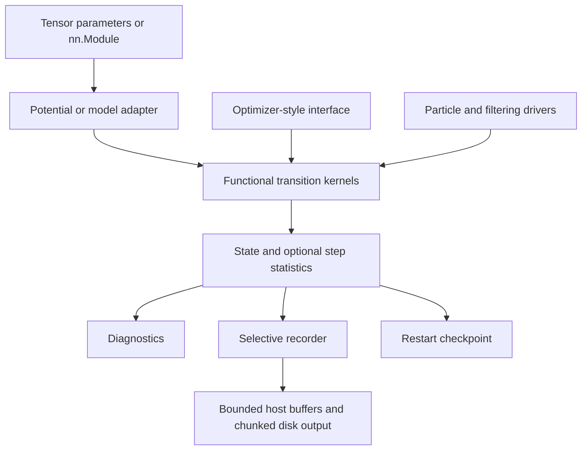

# The-LaFA: architecture and phased implementation plan

Status: approved for execution. User additionally requests a single reference document, a 2D nonlinear inverse-problem test, and a hard total RunPod budget of USD 10.

Current delivery: [algorithm register](../research/algorithm-register.md), [consolidated references](../references.md), and [validation evidence](../validation.md). This document preserves the approved roadmap; the register records the implemented variants and remaining extensions.

Goal: a PyTorch-native library for uncertainty quantification, covering all six requested algorithm families, with optimizer-style use, CPU/CUDA execution, reproducible numerical validation, and bounded-memory recording.

Scope of this planning round: repository inspection, the supplied paper, primary-source discovery and review, architectural decisions, delivery order, validation, and documentation design. Exa is unavailable in this session; the user authorized primary sources for now. Exa review remains outstanding. Abstract-level review is distinguished from full algorithm derivation in the research notes. No claim of exhaustive literature coverage is made.

## 1. Recommended architecture

Three approaches were considered:

| Approach | Benefit | Limitation |
|---|---|---|
| Everything inherits `torch.optim.Optimizer` | Familiar parameter groups and checkpoints | Forces diagnostics, weighted particles, and filtering into an unsuitable model |
| Pure functional inference framework | Clear transitions, batching, compilation and mathematical testing | More work for users accustomed to optimizer workflows |
| **Functional numerical core with thin optimizer adapters and specialized drivers** | Familiar usage plus explicit scientific semantics | Requires carefully tested contracts between the interfaces |

Recommend the third. Use composition and small typed protocols, avoiding a large inheritance hierarchy, dynamic plugin system, or a universal class controlled by many flags.



### Mathematical and target contracts

- Canonical potential: `U(x) = -log pi(x)` up to an additive constant. Explicit temperature uses `pi_T(x) ∝ exp(-U(x)/T)`.
- Baseline ULA with a constant SPD mobility `M`: `x_next = x - h M grad U(x) + sqrt(2 h T) M^(1/2) noise`. Fix this normalization in documentation and deterministic tests.
- Distinguish `potential`, `log_prob`, and `score` adapters by name and validate their contracts; no ambiguous generic loss sign.
- Expose independent chains and interacting particles as distinct axes/types. A batched potential returns one value per independent chain; it must not accidentally reduce the chain axis.
- Parameter groups describe block step sizes or fixed mobility where mathematically valid. MALA accepts or rejects the full proposed state per chain using the full joint proposal density, not each parameter tensor independently.
- Constant diagonal mobility first; dense small-dimensional reference implementations next; matrix-free operators for large problems. Operators expose application, square-root noise sampling, and solves/log-determinants only where required. Applying `M` directly to Gaussian noise does not produce covariance `M`.
- State-dependent mobility needs the appropriate drift/divergence treatment or a valid correction. Do not add arbitrary Adam/RMSprop preconditioning while retaining an unchanged posterior guarantee.
- Support constrained parameters through explicit transforms and log-Jacobians, or a specifically derived constrained algorithm. Clipping is not a generic posterior sampler.

### Public API proposal

Proposed names are design decisions for review, not existing APIs.

| Interface | Responsibility |
|---|---|
| `lafa.ULA(params, lr=..., temperature=..., generator=...)` | Optimizer-style adapter; inherits parameter groups, `zero_grad`, `step`, `state_dict`, `load_state_dict` conventions |
| `lafa.MALA(params, lr=..., generator=...)` | Requires a deterministic, repeatable closure that recomputes scalar potential and gradients at each requested state |
| `lafa.functional.*_step(...)` | Tensor-level numerical transitions with explicit state and externally supplied randomness for reference tests |
| `lafa.ParticleSystem(...)` | Explicit ensemble axis, particle weights when applicable, batched target evaluation |
| `lafa.StateSpaceModel(...)` | Transition, observation model, their noise laws, and unknown parameters for filtering |
| `lafa.LatentVariableModel(...)` | Shared learned parameters and latent particles for PIPLA |
| `lafa.diagnostics.ksd(...)` | Diagnostic independent of the sampler |
| `lafa.recording.Recorder(...)` | Field selection, timing semantics, buffered persistence and readers |

The optimizer closure follows the usual pattern: zero gradients, evaluate the potential, call backward, return the scalar potential. Gradient-only ULA can consume `.grad`; MALA must reevaluate both current/proposed densities as needed. Pure functional targets use autograd internally and do not require `.grad` mutation. Make the two contracts explicit in examples.

Use `torch.func.functional_call`, `grad`, `vmap`, JVP and VJP where supported. Eager evaluation is the reference path and the fallback for valid models that cannot be transformed/compiled. Avoid mutating module parameters to evaluate many particles.

Capability declarations document each method's need for gradients, full potential values, Hessian-vector products, proximal maps, latent variables, observations, or particle interactions. GPU compatibility follows supported PyTorch operations; arbitrary nondifferentiable, sparse, complex, stateful, or custom CUDA models are not automatically supported. Give actionable errors for unsupported combinations.

### State and reproducibility

State includes current parameters, cached potential/gradient with validity information, momenta, step-size/adaptation history, projection bases, temperatures, particle weights, filter statistics, and owned RNG streams as applicable.

Checkpoint both state and run metadata: schema version, parameter ordering, iteration, warm-up status, algorithm configuration, generator states per device, data/schedule position, software/hardware versions, and recording position. Target/model code and dataset identity are referenced rather than implicitly serialized as executable objects.

Test exact continuation on a supported fixed device/software stack. CPU/CUDA results need numerical and statistical agreement, not identical random trajectories. Independent chains receive independent explicit RNG streams. Checkpointing external stochastic models requires their RNG/buffer state too.

## 2. Algorithm coverage and implementation strategy

Every requested family stays in scope. Broad labels require a named mathematical formulation before a class is implemented. No generic placeholder will be advertised as an implementation of an unresolved method.

| Family | Planned coverage | Implementation and scientific controls |
|---|---|---|
| Overdamped | ULA, MALA, Lip-ULA, Lip-MALA; anchored Langevin based on Gürbüzbalaban et al. (2025), subject to full derivation review | Vectorized drift/noise; cached gradients; stable log acceptance; complete rejection restoration. Anchor/reference-potential methods must use their derived scaling rather than an invented attraction term. |
| Inertial / higher order | Kinetic Langevin, a BAOAB splitting integrator; explicit higher-order formulation after derivation review | Exact Ornstein–Uhlenbeck substep where applicable, explicit mass/friction, momentum state. Test invariant-measure order separately from strong/weak trajectory order; BAOAB is not universally fourth-order. HOLA-type overdamped methods belong in the documented cross-family map. |
| Inhomogeneous / specialized | Annealed Langevin; tempered Langevin with replica exchange; PIPLA variants MYIPLA, PIPULA and PIPGLA; source-specific adaptive-step/momentum schemes | Separate temperature annealing from noise-level score annealing. Test exchange ratios. Implement proximal/latent-parameter updates explicitly. Momentum requires calibrated noise/friction, not an arbitrary optimizer momentum term. |
| Stein particle methods | SVGD, pSVGD, Stein variational Newton, weight-space and function-space variants | Exact tiled pair interactions first. Likelihood-informed projection for pSVGD, including treatment of the complement. Matrix-free Newton operators and Krylov solves, with damping/definiteness checks. Function-space kernels need model-output maps and VJPs, not just parameter-space kernels with another label. |
| KSD | IMQ and RBF kernels; exact V-statistic and U-statistic; weighted version and explicitly approximate estimators | Shared analytic Stein kernels, FP64 references, chunked reductions. A U-statistic estimate of squared KSD may be negative; do not silently clamp and present it as an unbiased nonnegative KSD. Kernel conditions and limitations are documented. |
| Ensemble / Kalman / WFR | Repulsive ensembles; SA-LEnKF; a selected KL-driven Wasserstein–Fisher–Rao/birth–death formulation | Reuse particle infrastructure but separate inference objectives. SA-LEnKF has streaming observation/time axes and parameter learning. WFR needs normalized weights or a specified birth–death mechanism and ancestry recording. Avoid dense parameter covariance matrices. |

PIPLA and SA-LEnKF include parameter estimation, not necessarily Bayesian posterior sampling of every shared parameter. Tutorials must label what is estimated and what is sampled. Finite SVGD/repulsive ensembles are not independent posterior draws. KSD is a diagnostic, not another sampler.

### Treatment of the supplied paper

Source: Izzatullah, van Leeuwen and Peter (2021), DOI `10.1093/gji/ggab287`; full supplied PDF inspected, including rendered algorithm page 1529, Section 4, Algorithms 1–2, Appendix A and the tomography portion of Appendix C.

The author has no separate erratum/reference implementation and authorized the best mathematically consistent interpretation. Implement and document these decisions:

1. Use `U=-log pi` consistently. Equation (6)'s positive log-density drift and the algorithms' printed negative log-density drift cannot both express that same target convention. The implementation descends `U`.
2. Use `log alpha = min(0, log pi(y)-log pi(x)+log q(x|y)-log q(y|x))`. The printed Algorithm 1 proposal-density ratio appears reversed relative to standard MH; do not copy it blindly.
3. Preserve the local Lipschitz rule's square-root growth cap, gradient-difference norm, step-ratio history, and dimension-dependent factor after independently transcribing and checking the recurrence. Resolve initialization, repeated states, zero denominators, rejection history, and nonfinite values explicitly.
4. Keep continuous-adaptation Lip methods identifiable as research variants. Do not assert exactness merely because Lip-MALA includes accept/reject. Offer an adaptation-during-warm-up, frozen-production mode with a fixed valid MALA kernel. This mode is a documented extension, not an exact reproduction of continuously adaptive pseudocode.
5. Distinguish reproducing the paper's qualitative findings from reproducing its original unpublished numerical code. Use analytic Gaussian posteriors and convergence/bias studies to adjudicate behavior; do not tune code to reproduce a table.
6. Reproduce the paper's Gaussian comparison and variance-inflation observations as a dedicated reference experiment; include its Rosenbrock-type density only after checking the rendered exponent/normalization. The generic banana benchmark can have its own explicitly normalized definition.

Write these as a transparent implementation note, not as an unqualified claim of an author-issued correction.

## 3. Efficient optional recording

Recording is opt-in. Default execution retains current algorithm state and bounded summaries, not the trajectory or autograd graphs.

- Select fields independently: accepted state, proposal, start/end gradient, potential, momentum, step size, acceptance, temperature, particle weights/ancestors, projection summaries, chosen model predictions, and user-derived quantities.
- Specify when each field was evaluated. A proposal gradient after rejection must not be labeled the accepted-state gradient. Recomputing an end-state gradient is explicit extra work if the method does not already have it.
- Select every-k steps, warm-up inclusion, parameter subsets, projections, or diagnostic summaries. Thinning is a storage choice, not a promise of better statistical efficiency.
- Detach before retention; copy selected values into recorder-owned buffers so later in-place updates cannot corrupt records. Never retain an autograd graph by default.
- Provide no-op, bounded in-memory ring/reservoir, chunked local disk, and optional Zarr sinks. A simple baseline uses array chunks plus a JSON manifest; numerical kernels remain entirely PyTorch. Array/plot/I/O dependencies live in extras.
- CUDA transfer path: bounded staging buffers, pinned host memory, a dedicated copy stream when safe, CUDA events for completion, and clear ownership before buffer reuse. Benchmark synchronous fallback and use it for small outputs when faster.
- Writer queue is byte bounded. Default backpressure blocks when storage is slow; dropping records is explicit and counted. Propagate writer failures and disk-full errors. `flush/close` ensures data completion.
- Write completed chunks atomically with a committed manifest and recovery metadata. On restart, reconcile checkpoint step and committed sample step without duplication or silent loss. Readers support slices/chunks without loading full trajectories.
- Use Welford mean/variance, selected cross-moments, bounded diagnostic windows and explicit subsampling. Exact long-chain ESS/autocorrelation may need stored data or an offline pass; do not promise all exact diagnostics in constant memory.
- Estimate disk and transfer costs before running: approximately `recorded_steps × recorded_chains_or_particles × recorded_scalars × bytes_per_scalar`, plus metadata and optional compression. Lossy storage dtype is explicit and never changes sampler state.

For illustration, one FP32 state and its full gradient with one million parameters require about 8 MB per recorded chain-step; 100,000 such records require about 800 GB uncompressed. No architecture removes that information cost.

## 4. Performance and HPC strategy

- Establish a simple eager FP64 reference before optimization; offer FP32 production after accuracy checks. Mixed precision, TF32, approximate kernels and lossy history are explicit options with measured accuracy impact, not defaults.
- Keep transitions and reductions on device; avoid `.item()`, CPU conversion, and device synchronization within hot loops except intentional reporting/control boundaries.
- Reuse scratch tensors, cache valid gradients and factorizations, and avoid repeated flatten/concatenate copies of large parameter lists. Detect invalid caches when targets/parameters change.
- Batch independent chains/particles using `vmap` or explicit chunking. Do not materialize `[particles, particles, parameters]` pairwise differences. Use algebraic kernel identities and bounded pair tiles; report remaining quadratic interaction time honestly.
- Use JVP/VJP/Hessian-vector operators and ensemble-space solves. Dense Hessians/covariances are small-problem references, not the large-dimensional default. A Krylov method requiring SPD operators must check or enforce that condition.
- Treat `torch.compile` as an opt-in accelerated path for compatible, stable-shape transitions. Keep recording and most orchestration outside compiled regions. Validate eager/compiled agreement and count compilation warm-up separately.
- Profile first with `torch.profiler` and synchronized CUDA timing. Benchmark parameter dimension, chain count, particle count and kernel tile size, including memory peaks and recording overhead.
- First GPU target: one NVIDIA CUDA device. Scale independent chains across GPUs before distributed interacting particles. Later particle sharding must account for communication costs and reduction order. Multi-node support is a separate validated extension, not assumed from CUDA support.
- No custom CUDA/Triton or additional mandatory numerical backend initially. Consider it only after profiling shows a bottleneck that public PyTorch operations cannot adequately address.

Initial compatibility proposal: Python 3.11+ and PyTorch 2.6+ using public APIs; confirm the actual minimum/current supported matrix in the first implementation milestone. Pin tested dependency/environment versions only after CPU/CUDA compatibility checks. Core runtime dependency is PyTorch; optional recording, plotting and notebook extras are separate.

## 5. Validation plan

Use CPU and real CUDA execution. GPU-marked tests skipped on a CPU runner do not satisfy GPU validation. Keep deterministic numerical tests distinct from stochastic quality experiments.

| Problem | Purpose | Reference / measurements |
|---|---|---|
| Analytic isotropic and correlated Gaussian | Sign, drift/noise covariance, acceptance and invariant bias | Exact moments; ULA discrete stationary covariance for stable step sizes; conditional proposal covariance; paper's Gaussian fixture |
| 2D multimodal Gaussian mixture | Mode exploration, weights, annealing and repulsion | Direct i.i.d. draws, known mode masses and moments; occupancy, transport/distribution errors, KSD and wall time |
| Normalizable 2D Rosenbrock/banana density | Curvature, correlation, integrator/adaptation behavior | Direct transformed sampling for the chosen normalized banana target, or independently converged quadrature; trace, autocorrelation, tails and bias |
| 2D straight-ray traveltime tomography | A spatial inverse problem with trusted posterior | Sparse ray-length operator, Gaussian likelihood/prior, exact small-grid posterior from linear solves; posterior means, variances and credible intervals. It is a 2D spatial field, not necessarily a two-parameter problem. |
| 2D nonlinear spatial inverse problem | Nonlinear likelihood and spatial uncertainty | Positive field on a 2D grid, nonlinear attenuation measurements through rays; full-field benchmark and two-coefficient version with converged 2D quadrature and posterior-predictive checks |
| Small latent-variable model with a nonsmooth penalty | PIPLA's actual learning objective | Reference proximal solution and low-dimensional marginal-likelihood or integration benchmark |
| Low-dimensional Laplace and suitable Student-t targets | Anchored methods beyond differentiable Gaussian examples | Direct reference draws; explicit reference potential and verified assumptions; compare only moments that exist and use tail quantiles otherwise |
| Linear Gaussian state-space model, then a nonlinear observation variant | SA-LEnKF's actual filtering/learning objective | Kalman-filter baseline for states; separately validated parameter estimation; nonlinear reference via small-dimensional quadrature/SMC with convergence checks |
| Small Bayesian neural-network regression problem | w-/f-SVGD and repulsive ensembles | Predictive intervals, function diversity and calibration; use a small reference posterior where feasible |

Tests include:

1. Scalar/tiny-tensor one-step reference equations with externally supplied noise; finite-difference gradients/JVPs and analytic kernel derivatives.
2. MALA log-ratio, joint parameter-group acceptance, nonfinite proposal rejection, exact rollback of parameter/gradient/cache state, and deterministic closures. Dropout/BatchNorm mutation must be handled explicitly, not silently permitted in an exact-density claim.
3. Kinetic momentum covariance, damping/noise limits and invariant-measure convergence; adaptive recurrence edge cases; replica-swap detailed balance with frozen valid component kernels.
4. Particle permutation equivariance, projection/complement behavior, positive normalized WFR weights, and correct latent/parameter noise scaling.
5. Dense-versus-tiled SVGD/KSD references, signed U-statistic handling, weighted-estimator checks, and explicit error from approximate estimators.
6. Reproducible checkpoint continuation; CUDA/CPU shape/dtype contracts; invalid states and unsupported sparse/complex inputs; empty/missing gradients and parameter aliases.
7. Recorder aliasing, gradient timestamp semantics, bounded memory after many steps, slow/disk-full writer behavior, flush, crash recovery and checkpoint/output alignment.
8. Distribution tests over fixed multiple seeds with predeclared uncertainty-based tolerances, avoiding fragile assertions from one lucky chain. For Gaussian ULA test its expected finite-step bias rather than demand exact target covariance.

Comparisons use equal target/gradient/forward-evaluation budgets and equal wall-time views, not just equal iteration counts. Report warm-up, tuning and compilation cost separately. Use ESS/s and rank-normalized R-hat for suitable stationary independent chains; do not apply ordinary chain ESS/R-hat to a single interacting particle population as if its particles were independent chains. Add mode coverage and credible-interval calibration because low KSD or good R-hat alone does not guarantee all modes were explored.

Performance acceptance: optimized and reference paths agree to dtype-appropriate tolerances; recorder memory stays bounded at fixed buffer configuration as run length grows; tiled pair algorithms do not allocate full pair-by-parameter tensors; every claimed speedup includes hardware, dimensions, dtype, warm-up and timing method. Set numerical speed/overhead targets from the first measured baseline rather than invent them now. Tiny 2D workloads need not be faster on GPU.

## 6. Repository layout

```text
src/lafa/
  targets.py                 # Potential, score and model contracts
  state.py                   # Typed numerical state and serialization schema
  functional/                # Reference and optimized tensor transitions
  optim/                     # Thin torch.optim-style adapters
  particles/                 # SVGD, projections, Newton and function-space methods
  specialized/               # PIPLA, filtering, WFR and tempering drivers
  kernels/                   # Shared kernels, derivatives and tiled reductions
  diagnostics/               # KSD and appropriate chain/ensemble summaries
  recording/                 # Selection, buffering, sinks, readers and recovery
  problems/                  # Reusable targets and inverse-problem fixtures
tests/
  unit/ integration/ statistical/ cuda/
benchmarks/                  # Repeatable performance/quality experiments
notebooks/                   # Six numbered tutorials
docs/
  algorithms/ research/ performance/ assets/
README.md
CITATION.cff
pyproject.toml
```

Each algorithm gets its own focused module as needed. Avoid duplicating numerical implementations in notebooks or maintaining both independently coded optimizer and functional versions.

## 7. Delivery milestones and review gates

All milestones require implementation authorization. The list is a delivery roadmap; precise per-method equation specifications and executable test cases are written before the corresponding method is coded, particularly for source-gated research variants.

| Milestone | Deliverable and principal files | Dependencies | Exit evidence |
|---|---|---|---|
| M0: scientific specifications | `docs/research/algorithm-register.md`, paper-interpretation note; formulation, citation, assumptions, target and computational complexity for every method | Approved architecture | Equation review; resolve anchored/higher-order variant identity; no unqualified correctness claims from adaptation or finite ensembles |
| M1: core vertical slice | `targets.py`, `state.py`, `functional/ula.py`, `optim/ula.py`, Gaussian fixture, packaging and tests | M0 core contracts | Installable package; optimizer and functional ULA agree; CPU/CUDA Gaussian tests; checkpoint continuation |
| M2: recording | `recording/{recorder,buffers,sinks,reader}.py`, recorder integration tests | M1 | Bounded-memory run, restart/recovery and slow-writer tests; selective GPU transfer benchmark |
| M3: overdamped and paper methods | MALA/Lip/anchored method modules, fixed mobility, constraints adapter; paper reference experiment; tutorial 01 | M1–M2 and paper note; anchored derivation review | Acceptance/rollback tests, Gaussian and banana references, anchored nonsmooth/tail checks, continuous-adaptation/frozen-production distinction |
| M4: inertial and schedules | Kinetic/BAOAB, selected higher-order integrator, annealing and tempering modules; tutorial 02 and first part of 03 | M3 | Momentum/invariant-measure tests, annealed target checks, swap ratio and mode exploration results |
| M5: shared kernels and diagnostics | `kernels/`, `diagnostics/ksd.py`, exact tiled implementations; tutorial 05 | M1–M2 | Analytic/dense references, IMQ/RBF and U/V tests, CPU/CUDA agreement and bounded pair memory |
| M6: Stein and repulsive methods | `particles/`, Hessian-vector/projection support, module adapter, tutorial 04 | M5 plus M0 specifications | Particle/functional equivalence tests, projection checks, Newton solver residuals, regression and inverse-problem comparisons |
| M7: specialized inference | PIPLA, SA-LEnKF, WFR drivers and their dedicated problem fixtures; complete tutorials 03 and 06 | M4–M6 as needed | Latent-model, Kalman and weighted/birth–death references; full six-family coverage |
| M8: performance and release evidence | Benchmarks, CUDA CI/RunPod runner, complete notebooks, README and API docs | M1–M7 | All CPU/CUDA validation artifacts; clean-kernel execution of six notebooks; documented limitations; reproducible performance report |

Deliver documentation/examples alongside each milestone; M8 verifies coherence rather than deferring all documentation until the end. M5 can be developed independently of M4 once contracts stabilize. Do not parallelize changes to shared contracts until they are reviewed and fixed.

Suggested review responsibilities: computational scientist owns derivations and invariant measures; PyTorch developer owns autograd/state/closure behavior; HPC specialist owns memory, kernels and timings; inverse-problem specialist owns forward models and truth references; test/documentation reviewer owns reproducibility and tutorial usability. These are proposed roles, not a claim that a team has already reviewed the design.

For each implementation task: add a meaningful failing numerical/contract test, implement the smallest coherent change, run relevant CPU/CUDA checks, review mathematical and software behavior, and commit only that reviewed unit. Research blockers for one method do not justify silently dropping that method or blocking independent foundations.

## 8. Six notebooks and concise README

Each notebook uses shared library problems/runners, explains equations and assumptions, exposes seed/device/dtype/budget, runs from a clean kernel, compares methods in its family, and produces actual figures and a compact timing/quality table. Include a quick CPU mode and a GPU/full experiment mode. Reference rendered outputs are generated from executed runs with metadata; never hand-draw synthetic performance claims.

| Notebook | Content and planned figures |
|---|---|
| `01_overdamped.ipynb` | ULA/MALA/Lip/selected anchored methods; target contours with samples, traces, mode occupancy, step-size history, acceptance and covariance bias |
| `02_inertial.ipynb` | Kinetic/BAOAB/selected higher-order method; position/momentum behavior, correlation, error versus step size, ESS/s where appropriate |
| `03_specialized.ipynb` | Annealing/tempering/adaptive methods on mixtures; temperature/mode traces; separate PIPLA latent-learning example with its own objective and comparison |
| `04_stein_particles.ipynb` | SVGD/pSVGD/SVN, w-/f-space methods; particle movement, projection accuracy, posterior/predictive comparisons and memory/time |
| `05_ksd.ipynb` | Correct versus mean-shifted, variance-distorted and mode-missing samples; IMQ/RBF, U/V, exact/approximate results and estimator uncertainty; KSD's failure modes |
| `06_ensemble_hybrid.ipynb` | Repulsive/WFR methods on inverse problems and a separate SA-LEnKF time-series example; weights/diversity, posterior fields, prediction intervals and filter performance |

All notebooks include CPU/GPU execution paths and comparative results on compatible tasks. Avoid a misleading single leaderboard across algorithms that solve different inference objectives.

README target: approximately 100–150 lines. Include a one-sentence purpose, one genuine sample/uncertainty illustration, installation and CUDA note, a 15–20-line minimal optimizer-style example, a six-family navigation table with maturity/assumptions, a short streaming-recording example, notebook/test commands, and citation. Put proofs, full API details, numerical caveats and performance tables in linked documentation. Include one small architecture diagram only if it improves navigation.

## 9. GPU environment and outstanding items

Prior onboarding saved a RunPod key requirement, REST API destination, and read-only startup check. This planning round has not verified that the key is now present, authenticated a pod, or executed CUDA. It creates no paid resources.

At implementation start: verify current secure configuration, list accessible pods read-only, inspect the selected pod's GPU/driver/CUDA compatibility, pin a suitable PyTorch environment, and execute the same test revision on CPU and GPU. Save logs, hardware/software versions and benchmark artifacts. Define device, spend cap, storage and shutdown policy before creating a paid pod. Use restartable jobs and checkpoints; do not rely on a live process surviving environment publication.

Outstanding decisions are limited to concrete research/hardware details: the precise anchored and higher-order formulations, per-variant adaptive guarantees, full-text derivations for sources reviewed only at abstract level, the outstanding Exa review, and the GPU resource/budget. The chosen sign/MH treatment no longer requires an author erratum. These are explicit gates for affected stages, not permission to claim those methods already work.

Execution authorized by the user; no further approval is needed for implementation or GPU work within the hard USD 10 total cap.
