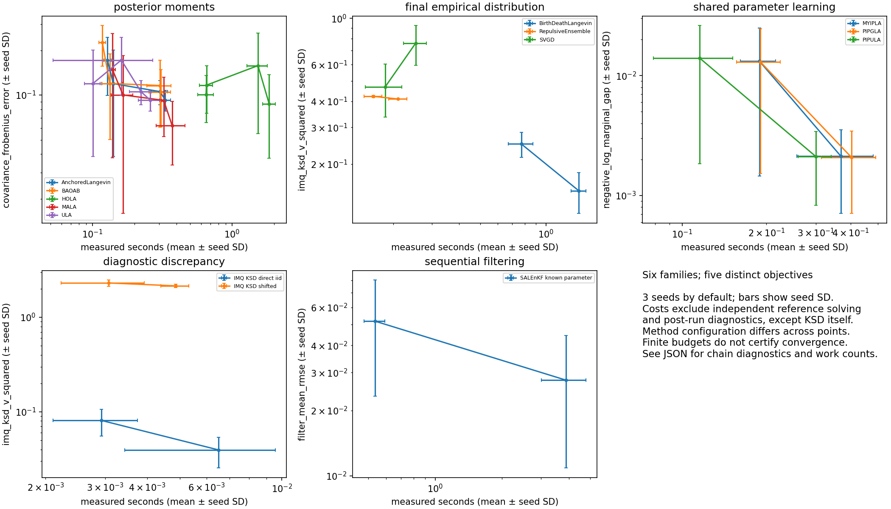
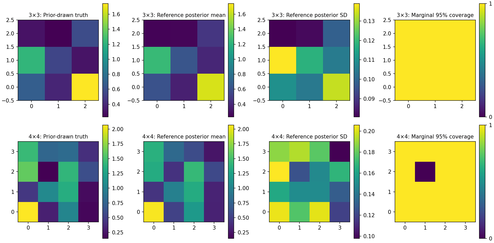

# Validation and measured limits

This is an initial scientific implementation, with reviewed formulas and finite numerical checks. It does not establish universal convergence, accuracy or acceleration for arbitrary PyTorch models. The [algorithm register](research/algorithm-register.md) defines each implemented subset; all sources are in [one reference document](references.md).

## Reproduce

```bash
bash scripts/setup_cloud.sh
/workspace/lafa-venv/bin/python -m pytest -q
/workspace/lafa-venv/bin/python scripts/execute_notebooks.py --device cpu
/workspace/lafa-venv/bin/python benchmarks/accuracy.py --device cpu --output /tmp/lafa-accuracy
/workspace/lafa-venv/bin/python benchmarks/performance.py --device cpu --compile --output /tmp/lafa-performance.json
/workspace/lafa-venv/bin/python -m build
```

The setup script was executed successfully and `pip check` passed. Wheel and source-distribution builds passed. The extracted source distribution independently passed the same 546 tests with 77 CUDA skips; a separately installed wheel ran compiled targets, selective MALA stepping and diagnostics outside the checkout. The [CPU CI workflow](../.github/workflows/tests.yml) runs Python 3.11/3.12 tests and package builds, plus all six tutorials and tests from an extracted source distribution on Python 3.12. See [current hosted results](https://github.com/izzatum/The-Langevin-algorithms-Family/actions/workflows/tests.yml) for revision-specific evidence. Local evidence uses Python 3.12.14.

## Evidence included in the repository

Final local suite: **546 passed, 77 skipped, 0 failed**. All skips require unavailable CUDA; the [JUnit artifact](../benchmarks/results/cpu/pytest.xml) records actual cases. Six notebooks executed in clean CPU kernels, including the new diagnostic, batched neural-network and full-grid spatial examples. See their [execution outcomes](../notebooks/execution-results.json).

| Artifact | Actual scope |
|---|---|
| [Environment metadata](../benchmarks/results/cpu/environment.json) | Linux x86_64, Python 3.12.14, PyTorch 2.6.0+cpu; numerical references primarily float64, one CPU thread. |
| [Six executed notebooks](tutorials.md) | Equations, actual outputs, seeds/dtype/device and short-budget limitations. |
| [Accuracy JSON](../benchmarks/results/cpu/accuracy.json) | 24 CPU runs: four problems × ULA/MALA × three seeds; retained `(64,120,2)` axes, work counts, moments, Rhat, bulk/tail ESS, mean/median MCSE and separate diagnostic timing. |
| [Six-family results](../benchmarks/results/cpu/families.json) | 114 runs and 38 method/budget summaries, three seeds; analytic Gaussian, integrated Normal/Laplace learning, exact-score KSD and Kalman references. |
| [CPU performance](../benchmarks/results/cpu/performance.json) | 250 configurations plus 12 compiled-target initializations: full sampler work, output modes, optimizer buffers, particles and recording. |
| [Neural-network results](../benchmarks/results/cpu/neural-network.json) | 108 loop/vmap/chunk configurations and four independent MALA chains for a full-data Bayesian network. |
| [Full-grid nonlinear results](../benchmarks/results/cpu/nonlinear-calibration.json) | All 9/16 latent cells, eight independent simulated datasets per grid, finite elliptical-slice references and three MALA step sizes. |
| Tests under `tests/` | Numerical/noise/MH oracles, callback ownership/autograd, rollback and checkpoint continuation, model buffers/tied parameters, blocked kernels, recording failures, independent diagnostic fixtures and benchmark work-count checks. |

[Reproduction commands](../benchmarks/README.md) specify the recorded experiment budgets. Raw neural-network/full-grid chains are kept outside Git; drivers can reproduce them. JSON and figures contain compact summaries. CPU results and skipped CUDA cases are never reported as GPU evidence.

## Chain diagnostics and family comparisons

Bulk ESS uses split rank-normalized draws; tail ESS uses quantile indicators. Mean/quantile MCSE and rank/folded split Rhat preserve independent chain and time axes. Frozen ArviZ 0.22/SciPy fixtures check IID, autocorrelated, heavy-tailed, antithetic, shifted and tied cases without adding those packages to runtime dependencies. LaFA conservatively caps ESS at retained count and reports undefined constant indicators as NaN; JSON reports nulls with explanations. Extreme-range regression oracles also check that folding and quantile indicators preserve order. Numerically ambiguous folded comparisons use exact CPU ranks; ordinary inputs retain the PyTorch path. Diagnostics cannot establish convergence or detect every missed mode.


The accuracy experiment retains poor mixing: maximum Rhat is about **1.68 for the mixture** and **1.87 for Rosenbrock**. Family Gaussian runs reach about 1.45 in short BAOAB chains. Equal transition counts are not equal computational cost. Work counters are actual callback/row counts; HOLA's exact quadratic provider does not measure a general model's derivative cost.



Across three seeds, KSD V squared for direct Gaussian draws decreases from 0.0811 ± 0.0255 at 64 draws to 0.0395 ± 0.0141 at 128 (mean ± seed SD); shifted samples remain near 2.2. Known-parameter filtering mean RMSE decreases from 0.0518 ± 0.0285 to 0.0276 ± 0.0168 at the larger combined particle/inner-loop budget. PIPGLA's integrated likelihood gap decreases from 0.0130 ± 0.0115 to 0.00208 ± 0.00137. These shared-theta outputs are learning estimates, not parameter-posterior samples. Finite fixed-bandwidth Stein/repulsive ensembles retain substantial error. Three replications and jointly changed budgets limit causal interpretation.

## Neural-network execution and posterior summaries

`ModulePotential` supports independent flattened model states using loop or chunked `vmap`; function-space maps/VJPs have a separate optional vectorized path. The CPU scaling sweep uses widths 8/32/128, data sizes 32/128 and 1/8/32 states. Scalar explicit neural-network formulas independently check values/gradients; maximum gradient discrepancy was 1.46×10⁻¹¹. Chunk activation sizes count one tensor, and shared-process RSS does not isolate total per-configuration memory.

A four-hidden-unit Bayesian network uses a deterministic full-data Gaussian likelihood and independent Gaussian weight prior. Four MALA chains retain 10,000 draws each after 5,000 warm-up steps. Predictive-function Rhat spans 1.002–1.026, while weight Rhat spans **1.055–1.402**. Weight mixing remains unresolved; neither the prediction plot nor its single-dataset pointwise coverage establishes calibrated posterior inference. Parameter symmetries and geometry matter beyond batching speed.

## Spatial inverse-problem references

The 2D traveltime fixture builds a sparse ray–cell length operator; a separate linear solve checks its small-grid Gaussian posterior. Nonlinear transmission uses `y = exp(-A exp(z)) + noise` with a Gaussian prior on latent log-attenuation `z`. Tutorial 6 preserves the two-coefficient smooth-field reduction and adds a separate nine-dimensional full-grid example.

For the reduced 4×4 fixture (seed 4), quadrature gives mean `(0.7661759013, -0.6303626438)` and covariance `[[0.0051209382, -0.0067437460], [-0.0067437460, 0.0263327541]]`. Resolution 160→320 changes its mean by 3.65×10⁻¹³; wider bounds at matched cell width change it by 3.18×10⁻¹¹. This is a reference for that explicitly reduced prior/model.

The separate full-grid experiment infers **every latent cell** on 3×3 and 4×4 grids. Eight datasets per grid draw truth and observations from the stated prior-predictive model. An independently implemented elliptical-slice sampler [R24](references.md#r24) supplies a finite reference, checked first against exact Gaussian conditioning. The Gaussian validation has Rhat near 1.001 and bulk ESS above 4,000; estimated mean errors are below 0.5 estimated MCSE.

References retain 16,000 draws per chain on 3×3 grids and 32,000 on 4×4 grids, each after 2,000 warm-up steps. All **8/8** 3×3 datasets pass the stated coordinate screen (Rhat <1.01, bulk/tail ESS >400); **5/8** 4×4 datasets pass. Worst-coordinate Rhat ranges 1.0035–1.0075 and 1.0055–1.0135 respectively; minimum-coordinate bulk ESS ranges 668–991 and 437–741. Three 4×4 references retain mixing warnings. All 48 short MALA candidate runs fail that strict screen, so differences from the reference are finite-run comparisons rather than established posterior bias.

Mean marginal field coverage across datasets is 0.9861 (3×3) and 0.9688 (4×4); observation-predictive coverage is 0.9514 and 0.9375. These descriptive values do not demonstrate exact 95% calibration. An independent artifact audit reproduced all 64 reference/candidate summaries and comparisons from saved raw chains.



Latent, physical-field and observation-predictive summaries include Monte Carlo errors. Coordinate coverage uses datasets as independent binomial trials and Wilson intervals; correlated cells are never counted as independent replications. Eight datasets give coarse calibration estimates. Simultaneous inclusion in all marginal intervals is not a calibrated 95% joint region. Candidate MALA errors are compared with the finite reference and combined mean MCSE; poor mixing limits both. See [error and coverage figures](../benchmarks/results/cpu/nonlinear-error-coverage.png).

## Memory and speed

Default owned snapshots and eager numerical checks remain intact. Native samplers can select result fields or use `advance` without retaining output histories. Optimizer scale buffers are reused when parameter groups are unchanged, while fresh parameters and closure gradients are evaluated on every call. Callback input isolation preserves sampler state, and optimizer exceptions restore parameters, gradients, internal histories and owned RNG; caller-owned external state remains outside rollback.

The 250-configuration CPU sweep measures complete ULA/MALA/BAOAB steps with Gaussian/nonlinear dense targets at dimensions 8/64/256, 32 chains and float32/64. Each row records five intervals of 120 transitions after warm-up. The median eager/compiled timing ratio is **1.308×**, ranging **0.712–2.772×**; ratios below one mean compilation was slower. The median full-result/no-result ratio is **1.074×**, with substantial host variability. These descriptive ratios are not universal speedups, equal-accuracy comparisons or GPU results.

Compiled target initialization spans 0.132–4.683 seconds with the disk cache retained. Compilation covers potential and input gradient; randomness, validation, MH decisions and selected output creation remain in the full timed sampler. Optimizer forced-rebuild/cached-scale median ratios are 1.073× for ULA and 1.056× for MALA; that comparison uses the same implementation with buffers forcibly rebuilt, not an older release.

Pair interactions avoid full N×N×D tensors and SVN avoids dense parameter Hessians. Structural memory tests do not measure every backend allocation. Recorder payload reservations are bounded, but metadata/serialization overhead remain additional. CUDA-to-host staging is synchronous; asynchronous mode overlaps disk writing. The older [functional-only performance artifact](assets/performance-cpu.json) is historical evidence, superseded for whole-sampler claims by the new benchmark.

## GPU and research gates

**No real CUDA execution has been completed.** The [RunPod controller](runpod.md) prepares a source payload and runs the tests and six notebooks with explicit CUDA, saves artifacts, and applies worker/time/budget bounds. Its helper tests run locally without allocating a GPU. The authorized total budget is **$10**. No GPU job has been submitted. A management-only check observed an idle A4000 worker despite minimum 0 workers; all task resources were removed. Billing returned $0 at cleanup on 2026-10-15, but reporting may lag. Five historical endpoint setup attempts now carry $5 of conservative ledger reservations; this is reserved budget, not invoiced spend.

The secure key currently permits `rest.runpod.io` and `api.runpod.io`. The latter is a valid management API and authenticated successfully; its endpoint job health path returned 404. RunPod documents the Serverless job API at **`api.runpod.ai`**, which returned 401 and needs adding to that same binding. Authenticated management access does not validate CUDA. Keep the `.io` destinations when adding `.ai` in environment settings. CPU outputs and skipped CUDA cases are never reported as GPU results.

Larger repeated-data calibration, more demanding full-grid/neural-network targets, nonlinear-observation SA-LEnKF, distributed/fused implementations and the Exa errata/author-code survey remain extensions or outstanding review. Published asymptotic assumptions do not disappear when an implementation passes its unit tests.
