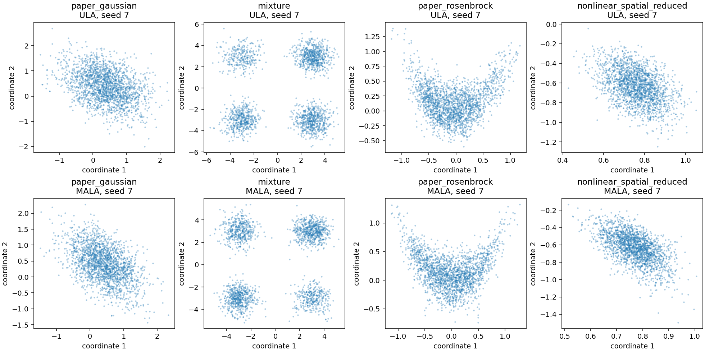

# Validation and measured limits

This is an initial scientific implementation, with reviewed formulas and finite numerical checks. It does not establish universal convergence, accuracy or acceleration for arbitrary PyTorch models. The [algorithm register](research/algorithm-register.md) defines each implemented subset; all sources are in [one reference document](references.md).

## Reproduce

```bash
bash scripts/setup_cloud.sh
/workspace/lafa-venv/bin/python -m pytest -q
/workspace/lafa-venv/bin/python scripts/execute_notebooks.py --device cpu
/workspace/lafa-venv/bin/python benchmarks/accuracy.py --device cpu --output /tmp/lafa-accuracy
/workspace/lafa-venv/bin/python benchmarks/performance.py --device cpu --compile --output /tmp/lafa-performance.json
/workspace/lafa-venv/bin/python -m build
```

The setup script was executed successfully and `pip check` passed. The package built as both wheel and source distribution; a separately installed wheel imported every public module family and ran a MALA smoke check outside the source checkout. The [CPU CI workflow](../.github/workflows/tests.yml) passed on Python 3.11 and 3.12, including package builds and all six tutorials in the Python 3.12 job: [hosted validation run](https://github.com/izzatum/The-Langevin-algorithms-Family/actions/runs/38781383039). Local evidence uses Python 3.12.14; consult [current workflow results](https://github.com/izzatum/The-Langevin-algorithms-Family/actions/workflows/tests.yml) for subsequent revisions.

## Evidence included in the repository

Final local suite: **314 passed, 73 skipped, 0 failed** in 14.52 seconds, including 44 offline RunPod helper cases. All 73 skips require unavailable CUDA. The [JUnit artifact](../benchmarks/results/cpu/pytest.xml) records 387 collected cases. The actual detached cleanup watchdog also acknowledged its ownership snapshot in a local subprocess check, then was terminated before any API call. All six notebooks reran successfully after the numerical fixes, with 28 executed code cells and no error outputs (61.74 seconds total).

| Artifact | Actual scope |
|---|---|
| [Environment metadata](../benchmarks/results/cpu/environment.json) | Linux x86_64, Python 3.12.14, PyTorch 2.6.0+cpu; numerical test fixtures primarily float64, one CPU thread. |
| [Six executed notebooks](tutorials.md) and [execution outcomes](../notebooks/execution-results.json) | Clean kernels, real outputs, explicit seeds/dtype/device. Short default budgets demonstrate behavior rather than certify convergence. |
| [Accuracy JSON](../benchmarks/results/cpu/accuracy.json) | 24 CPU runs: four problems × ULA/MALA × three seeds (7, 19, 31); 64 chains, 100 warm-up and 300 production transitions, retained every 5. Records target-evaluation counts, moment errors, intervals, acceptance, mode occupancy and timing. |
| [CPU performance JSON](assets/performance-cpu.json) | Small state/dimension and particle-count sweeps, recording off/synchronous/asynchronous/sparse, real flush and staging costs. Functional ULA compilation measured separately. |
| Tests under `tests/` | Equation/noise oracles, acceptance/rollback, gradients and VJPs, exact joint proximal KKT conditions, tiled/dense kernels and KSD, Newton residuals, stage filtering, checkpoint continuation, memory-shape assertions and recording failure/recovery. CUDA cases skip explicitly on this CPU machine. |



The Gaussian experiment shows expected finite-step ULA variance inflation: covariance Frobenius errors about 0.097–0.105, versus 0.008–0.017 for MALA at this budget. Short Rosenbrock runs retain substantial error. Mixture mode fractions measure observed exploration and do not prove mixing. These comparisons use equal transition counts and report evaluation counts/time; they are not an equal-cost or asymptotic efficiency leaderboard.

## Spatial inverse-problem references

The 2D traveltime fixture constructs a sparse ray–cell length operator and checks its small-grid Gaussian posterior against an independent linear solve. The nonlinear fixture uses a positive spatial field `exp(z)` and transmission `exp(-A exp(z))`, with a prior on `z`. The full spatial forward and gradient are checked; quantitative posterior reference results use a separately declared two-coefficient smooth-field reduction.

For the reduced 4×4 nonlinear fixture (seed 4), quadrature gives mean `(0.7661759013, -0.6303626438)` and covariance `[[0.0051209382, -0.0067437460], [-0.0067437460, 0.0263327541]]`. Refining resolution 160→320 on `[-2,2]²` changes the mean by 3.65×10⁻¹³; expanding to `[-3,3]²` at matched cell width changes it by 3.18×10⁻¹¹. Outermost-cell mass is 8.2×10⁻¹². This is a numerical reference for the reduced model, not a proof about a full-grid posterior.

Tutorial 6's actual nonlinear MALA run has acceptance approximately 0.80 and coefficient-mean error approximately 0.00072 against quadrature. Its displayed field mean and standard deviation propagate every retained coefficient sample through the nonlinear spatial map. The separate accuracy experiment uses three seeds; reduced nonlinear MALA mean errors range approximately 0.001–0.013. Credible intervals are posterior summaries, not automatically calibrated frequentist coverage or Monte Carlo error bars.

## Memory and speed

Pair interactions avoid full N×N×D tensors; SVN avoids dense parameter Hessians; recorder tests exercise alias ownership, bounded tensor reservations, producer backpressure, writer failure and recovery. Those structural checks do not measure every backend allocation. Recorder metadata and serialization overhead remain outside the tensor cap. CUDA-to-host staging is synchronous; asynchronous mode overlaps disk writes only.

In the included CPU run, 60 full eager ULA steps for 32 chains took about 0.010 seconds at dimension 8 and 0.027 seconds at dimension 256. At dimension 64, recording every step increased elapsed time by about 60–80% in this small workload; sparse recording saved storage. Asynchronous disk writing did not improve this particular short run. These are local measurements, not performance guarantees.

The first functional ULA call, including compiler/cache initialization, took about 4.91 seconds; 60 warmed compiled calls took 0.00065 seconds versus 0.00114 seconds eager. This was not a forced cold-cache compilation. This measurement excludes potential/gradient evaluation, noise generation, sampler snapshots and recording. No end-to-end speedup or GPU speedup follows from it. Eager finite-state validation, Python loops and owned result snapshots remain optimization opportunities after profiling a real workload.

## GPU and research gates

**No real CUDA execution has been completed.** The [RunPod controller](runpod.md) prepares a source payload and runs the tests and six notebooks with explicit CUDA, saves artifacts, and applies worker/time/budget bounds. Its helper tests run locally without allocating a GPU. The authorized total budget is **$10**. No GPU job has been submitted. A management-only check observed an idle A4000 worker despite minimum 0 workers; all task resources were removed. Billing returned $0 at cleanup on 2026-10-15, but reporting may lag. Five historical endpoint setup attempts now carry $5 of conservative ledger reservations; this is reserved budget, not invoiced spend.

The secure key currently permits `rest.runpod.io` and `api.runpod.io`. The latter is a valid management API and authenticated successfully; its endpoint job health path returned 404. RunPod documents the Serverless job API at **`api.runpod.ai`**, which returned 401 and needs adding to that same binding. Authenticated management access does not validate CUDA. Keep the `.io` destinations when adding `.ai` in environment settings. CPU outputs and skipped CUDA cases are never reported as GPU results.

Broader tail/calibration studies, full-grid nonlinear posterior comparisons, nonlinear-observation SA-LEnKF, larger neural-network experiments, distributed/fused implementations and the Exa errata/author-code survey remain extensions or outstanding review. Published asymptotic assumptions do not disappear when an implementation passes its unit tests.
